<!-- 1. Custom Animated SVG Hero + Live Terminal -->

  

---

### Live Telemetry & Tech Pipeline

  

---

### Flagship Products *(Animated Live Preview)*

  

<strong>Click to Explore All Projects & Live Links</strong>

 

| Product / Repo | What It Solves & My Role | Stack | Links |
| :--- | :--- | :--- | :--- |
| **Sahamara** | Retail investor analytics SaaS (Stock Screener, Foreign-Flow & automated IG/TikTok content pipeline) | `Next.js` `Python` `PostgreSQL` `Make.com` | [Live](https://sahamara.com) &bull; [Repo](https://github.com/YudaFH/sahamara-public) |
| **PintuAcara** | End-to-end event SaaS automating registration, payments, **real-time QR check-in** & e-certificates | `Laravel` `PHP` `MySQL` | [Live](https://pintuacara.com) &bull; [Repo](https://github.com/YudaFH/pintuacara-public) |
| **LungSphere** | AI respiratory sound screening (`.wav`) using **DWT-MFCC** & **SVM/Random Forest** (25-fold CV) | `Python` `Flask` `Scikit-learn` | [Live](https://lungsphere.vercel.app) &bull; [Repo](https://github.com/YudaFH/lungsphere) |
| **Stukka Digital** | Event operations, crew scheduling, biometric attendance & financial margin admin system | `Laravel` `PHP` `MySQL` | [Live](https://stukkadigital.com) &bull; [Repo](https://github.com/YudaFH/stukka) |
| **Web Portofolio** | Interactive editorial portfolio with live Looker Studio embed, interactive Power BI charts & animated UI | `HTML/CSS` `JavaScript` `Python` | [Live](https://yudafh.vercel.app) &bull; [Repo](https://github.com/YudaFH/web-portofolio) |

---

### Interactive Experience & Impact *(Click to Expand)*

<strong>1. Bursa Efek Indonesia (IDX) — Market Development Intern (Jul 2026 – Present)</strong>

 

- **Audit Realisasi RDIS:** Audited budget vs realization, participant data & supporting documents across **15 IDX Representative Offices (Kantor Perwakilan)**.
- **React & Python Investor Dashboards:** Maintained & enhanced analytics dashboards covering **RDIS, SID, and IDX Mobile** datasets for management presentations.
- **Looker Studio & Power BI:** Built multi-page Looker Studio geo-analytics & operational reports integrating educational events and business travel data.

<strong>2. PT Bayer Indonesia — Digital Developer Intern, Supply Chain & Ops (Apr – Jul 2025)</strong>

 

- **Excel VBA Logsheet Automation:** Automated daily production & packaging logsheets, saving **20–30 minutes per shift** across 15–20 daily entries.
- **Legacy-to-SharePoint Migration:** Built automated data transfer pipelines from legacy factory sheets into centralized **SharePoint** lists.
- **Power BI Operational Dashboards:** Designed interactive Power BI dashboards tracking production batch output, solvent usage, and QC metrics.

<strong>3. Leadership & National Competitions</strong>

 

- **Top 10 Finalist** — Microsoft AI Impact Challenge Hackathon (2026)
- **Finalist** — Hackathon Digdaya Bank Indonesia (`PintuAcara`, 2026)
- **3x 2nd Place Winner** — National Stock Trading Competitions (Ubaya 2024, UBB 2024, Unila 2023)
- **Vice Chairman** — KSPM Mercu Buana & **Chief Executive** of MINFEST 2025

---

### Contribution Snake & Live Analytics

  <picture>
    <source media="(prefers-color-scheme: dark)" srcset="https://raw.githubusercontent.com/YudaFH/YudaFH/output/github-contribution-grid-snake-dark.svg" />
    <source media="(prefers-color-scheme: light)" srcset="https://raw.githubusercontent.com/YudaFH/YudaFH/output/github-contribution-grid-snake.svg" />
    
  </picture>

  
  

  

