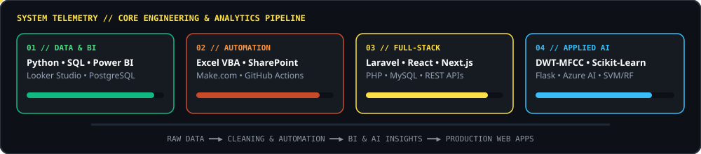
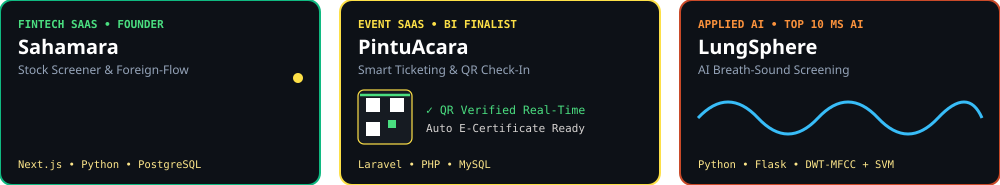

Informatics Engineering graduate (**GPA 3.78 / 4.00**, Universitas Mercu Buana) focused on operational data analytics, BI dashboards, workflow automation, and full-stack web engineering.

[Portfolio](https://yudafh.vercel.app/) · [LinkedIn](https://www.linkedin.com/in/yuda-farid-habibie-43201a352) · [Email](mailto:yudafaridhabibie@gmail.com)

---

### Architecture & Core Stack

---

### Selected Products

<strong>Experience &amp; Project Details</strong>

 

- **Bursa Efek Indonesia (IDX)** — *Market Development Intern* (`Jul 2026 – Present`): Audited budget realization & activity data across **15 Representative Offices**, maintained **React & Python** investor analytics dashboards (RDIS, SID, IDX Mobile), and built **Looker Studio** & **Power BI** reporting workflows.
- **PT Bayer Indonesia** — *Digital Developer Intern* (`Apr – Jul 2025`): Automated daily production logsheets using **Excel VBA** (saving **20–30 min/shift**), migrated legacy flows to **SharePoint**, and designed **Power BI** operational dashboards.
- **Recognition:** Top 10 Finalist *Microsoft AI Impact Challenge (2026)* · Finalist *Bank Indonesia Hackathon Digdaya (2026)* · 3× 2nd Place *National Stock Trading Competitions* · BNSP Junior Web Programmer.

| Project | Overview | Stack | Links |
| :--- | :--- | :--- | :--- |
| **Sahamara** | Retail investor analytics SaaS featuring Stock Screener & Foreign-Flow tracking | `Next.js` `Python` `PostgreSQL` | [Live](https://sahamara.com) · [Code](https://github.com/YudaFH/sahamara-public) |
| **PintuAcara** | End-to-end event platform with payments, QR check-in & auto e-certificates | `Laravel` `PHP` `MySQL` | [Live](https://pintuacara.com) · [Code](https://github.com/YudaFH/pintuacara-public) |
| **LungSphere** | AI respiratory sound screening (`.wav`) using DWT-MFCC & SVM/Random Forest | `Python` `Flask` `Scikit-learn` | [Live](https://lungsphere.vercel.app) · [Code](https://github.com/YudaFH/lungsphere) |
| **Stukka Digital** | Event operations & booking platform with crew scheduling & financial reporting | `Laravel` `PHP` `MySQL` | [Live](https://stukkadigital.com) · [Code](https://github.com/YudaFH/stukka) |
| **Web Portfolio** | Interactive portfolio with Looker Studio embed, Power BI charts & bilingual CV | `HTML/CSS` `JavaScript` `Python` | [Live](https://yudafh.vercel.app) · [Code](https://github.com/YudaFH/web-portofolio) |

---

### Contribution Activity

<picture>
  <source media="(prefers-color-scheme: dark)" srcset="https://raw.githubusercontent.com/YudaFH/YudaFH/output/github-contribution-grid-snake-dark.svg" />
  <source media="(prefers-color-scheme: light)" srcset="https://raw.githubusercontent.com/YudaFH/YudaFH/output/github-contribution-grid-snake.svg" />
  
</picture>
